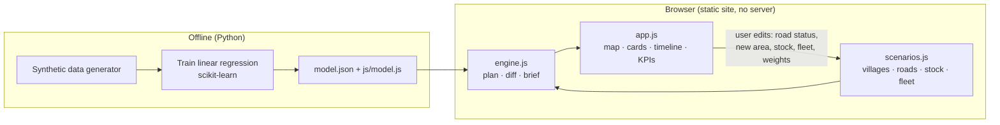
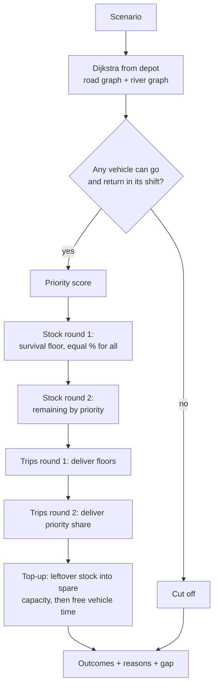
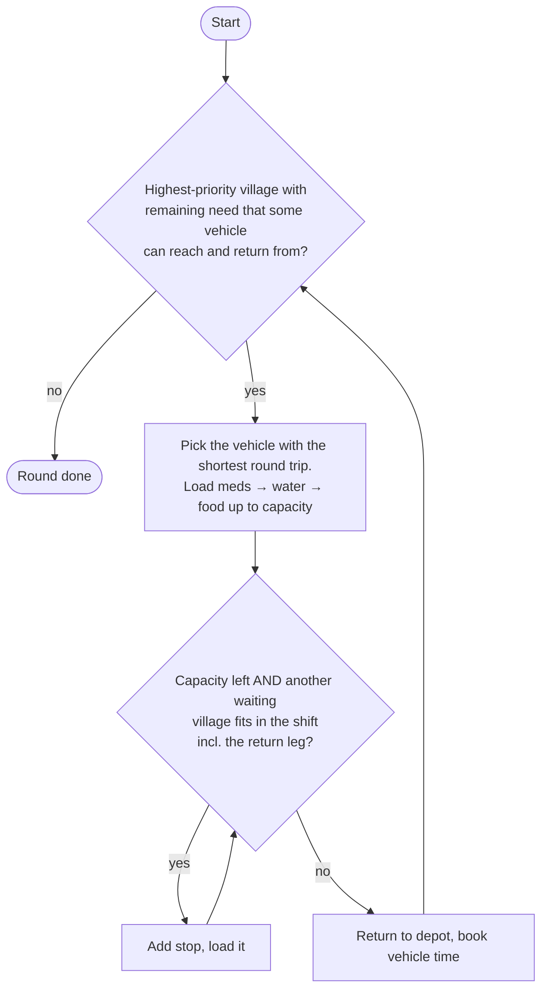
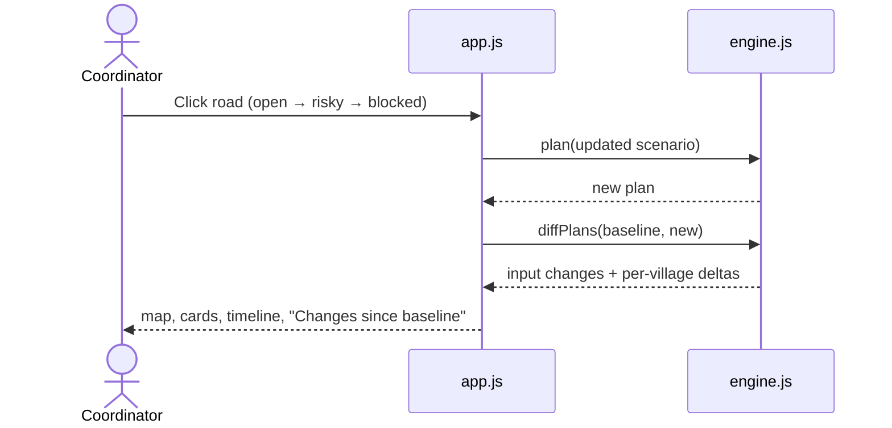

# Architecture

## System overview



## Planning pipeline (engine.js → `plan()`)



## Trip building (greedy multi-stop)



## Twist loop



## Data model

```js
village  = { id, name, x, y, people, infants, elderly, pregnant, injured,
             urgency /*1-5*/, daysSinceAid, verified, waterSource,
             request: { food, water, meds } }
edge     = { id, a, b, minutes, mode: "road" | "river", name,
             status: "open" | "risky" | "blocked", hazard? }
stock    = { food, water, meds }
settings = { weights, floorPct, unverifiedFactor, handlingMin,
             trucks: { count, capacityKg, shiftMin },
             boats:  { count, capacityKg, shiftMin, enabled } }
```

## Plan result (simplified)

```js
{
  villages: [{ id, name, rank, score: { score, parts[] }, status, coverage,
               resources: { water: { requested, delivered, short, ... }, ... },
               reasons[], flags[], estimate }],
  trips:    [{ n, round, vehicle, start, end, kg, stops: [{ villageName, arrive, load }] }],
  totals, summary, gap, fleet, inputs
}
```
